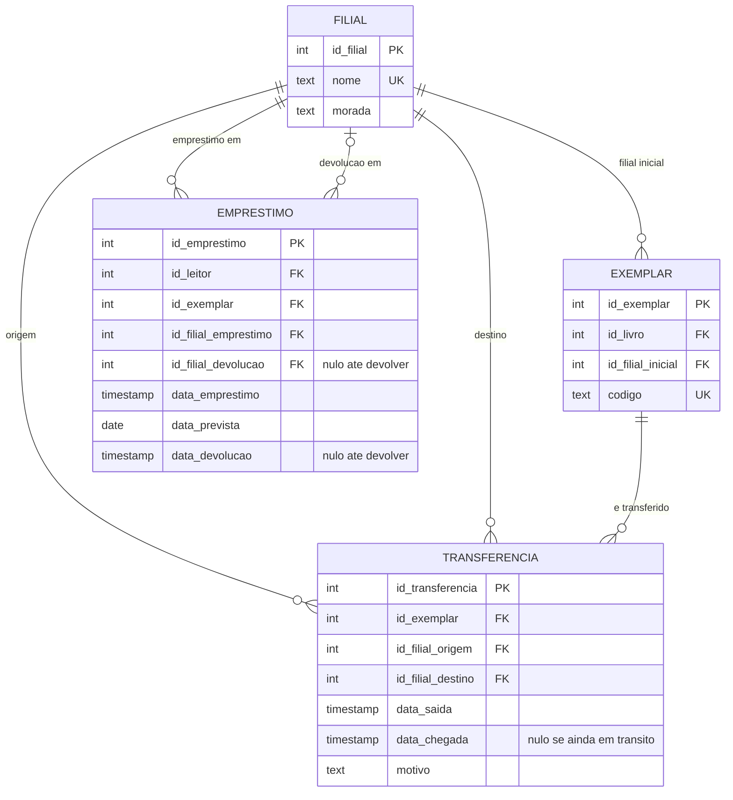

# Desafio: filiais, transferências e BCNF

## Parte 1: filiais e transferências

A biblioteca passa a ter 3 filiais. Preciso de saber onde está cada exemplar em qualquer momento e de guardar o histórico das transferências.

O que mudei em relação ao `model.md`:

- Criei a tabela `filial`.
- No `exemplar` pus `id_filial_inicial`, que é a filial onde o exemplar começou.
- Criei a tabela `transferencia`, com o exemplar, a filial de origem, a filial de destino e as datas.
- No `emprestimo` pus a filial onde foi feito o empréstimo e a filial onde foi devolvido (esta fica nula até devolver).

Tabelas:

- `filial` (**id_filial** PK, nome UK, morada)
- `exemplar` (**id_exemplar** PK, id_livro FK, id_filial_inicial FK, codigo UK)
- `transferencia` (**id_transferencia** PK, id_exemplar FK, id_filial_origem FK, id_filial_destino FK, data_saida, data_chegada, motivo)
- `emprestimo` (**id_emprestimo** PK, id_leitor FK, id_exemplar FK, id_filial_emprestimo FK, id_filial_devolucao FK, data_emprestimo, data_prevista, data_devolucao)

Restrições: a origem tem de ser diferente do destino, e `data_chegada` não pode ser antes de `data_saida`.

**Histórico:** são todas as linhas de `transferencia` desse exemplar, por ordem de `data_saida`. Só se acrescentam linhas, não se apagam.

**Onde está o exemplar num momento `t`:** é o destino da última transferência que já chegou até `t`. Se não houver nenhuma, é a filial inicial. Se houver uma transferência que saiu antes de `t` e ainda não chegou, está em trânsito.

**Devolução noutra filial:** se a filial da devolução for diferente da do empréstimo, também se regista uma transferência com motivo "devolucao". Assim a localização vem sempre da mesma tabela.

**Não guardei a "filial atual" no exemplar** porque se pode calcular com as transferências, e se a guardasse tinha de a atualizar sempre (anomalia de atualização). Por isso continuo sem desnormalizar.

## Parte 2: 3FN mas não BCNF

No meu modelo **não encontrei nenhuma tabela** que esteja em 3FN e não esteja em BCNF.

Fui ver tabela a tabela. Em todas, as colunas que determinam outras são chaves (a PK ou as colunas UNIQUE, como `isbn`, `email` e `codigo`). Na `transferencia`, o par `(id_exemplar, data_saida)` também é chave candidata, mas é uma chave, por isso está bem. Para a BCNF falhar tinha de haver uma coluna que não é chave a determinar outra, e isso não acontece.

**Diferença entre 3FN e BCNF:**

- Na 3FN, uma dependência `X → Y` é aceite se `X` for chave **ou** se `Y` fizer parte de uma chave candidata.
- Na BCNF, `X` tem de ser chave sempre, sem essa exceção.

Só dá diferença quando a tabela tem chaves candidatas compostas que se sobrepõem. Exemplo que poderia aparecer na biblioteca, com a regra de que cada bibliotecário trabalha só numa filial:

`atendimento (id_leitor, id_filial, id_bibliotecario)`

- `(id_leitor, id_filial) → id_bibliotecario`
- `id_bibliotecario → id_filial`
- Chaves candidatas: `(id_leitor, id_filial)` e `(id_leitor, id_bibliotecario)`

Está em 3FN porque `id_filial` faz parte de uma chave candidata. Mas não está em BCNF, porque `id_bibliotecario` não é chave e determina `id_filial`. A filial do bibliotecário repete-se em cada atendimento, e se ele mudasse de filial era preciso mudar várias linhas.

Para corrigir, separava em duas tabelas:

- `bibliotecario` (**id_bibliotecario** PK, id_filial FK)
- `atendimento` (**id_leitor** PK, FK; **id_bibliotecario** PK, FK)

O problema é que a regra "um leitor tem só um bibliotecário por filial" já não se consegue garantir só com uma chave, e teria de ser verificada à parte.

Como o meu modelo não tem uma tabela assim, a resposta é que não existe nenhuma, e o exemplo serve só para mostrar a diferença.