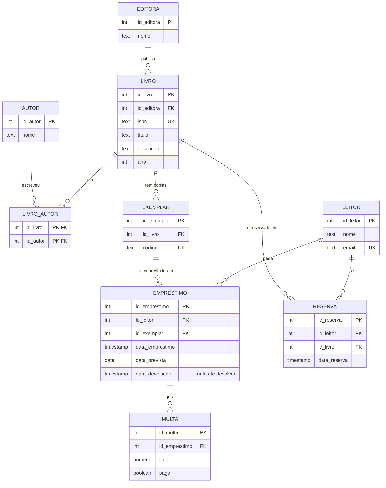

# Modelo de dados: biblioteca municipal

## 1. Diagrama ER

### Cardinalidades

| Relação | Cardinalidade | Notas |
|---|---|---|
| editora → livro | 1:N | uma editora publica vários livros; cada livro tem uma editora |
| livro ↔ autor | N:N | resolvida pela tabela de associação `livro_autor` |
| livro → exemplar | 1:N | um livro tem várias cópias físicas |
| leitor → empréstimo | 1:N | um leitor pode ter vários empréstimos (ou nenhum) |
| exemplar → empréstimo | 1:N | ao longo do tempo, um exemplar é emprestado várias vezes |
| empréstimo → multa | 1:N | um empréstimo pode gerar zero ou mais multas |
| leitor → reserva | 1:N | um leitor pode fazer várias reservas |
| livro → reserva | 1:N | um livro pode ser reservado por vários leitores |

## 2. Tabelas em 3FN

- `editora` (**id_editora** PK, nome)
- `autor` (**id_autor** PK, nome)
- `livro` (**id_livro** PK, id_editora FK → editora, isbn UK, titulo, descricao, ano)
- `livro_autor` (**id_livro** PK, FK → livro; **id_autor** PK, FK → autor)
- `exemplar` (**id_exemplar** PK, id_livro FK → livro, codigo UK)
- `leitor` (**id_leitor** PK, nome, email UK)
- `emprestimo` (**id_emprestimo** PK, id_leitor FK → leitor, id_exemplar FK → exemplar, data_emprestimo, data_prevista, data_devolucao)
- `reserva` (**id_reserva** PK, id_leitor FK → leitor, id_livro FK → livro, data_reserva)
- `multa` (**id_multa** PK, id_emprestimo FK → emprestimo, valor, paga)

### Porque está em 3FN

- **1FN:** todas as colunas guardam um único valor. Os vários autores de um livro não estão numa lista, estão em linhas de `livro_autor`.
- **2FN:** a única chave composta é a de `livro_autor`, que não tem colunas fora da chave. Nas restantes tabelas a chave é uma só coluna (`id_...`).
- **3FN:** nenhuma coluna não chave depende de outra coluna não chave. O nome da editora está só em `editora`, o título só em `livro` (não em `exemplar`), o nome e email do leitor só em `leitor`.
- **Chaves:** uso chaves substitutas (`id_...`) em todas as tabelas, e mantenho as chaves naturais (`isbn`, `email`, `codigo` do exemplar) como restrições `UNIQUE`.
- **Colunas anuláveis:** `data_devolucao` é nula enquanto o exemplar não for devolvido. As restantes colunas são `NOT NULL`.

## 3. Desnormalização

**Não faço nenhuma.**

Candidatos que considerei:

- **Estado do exemplar (disponível/emprestado):** poderia guardar uma coluna `disponivel` em `exemplar` para evitar procurar empréstimos sem `data_devolucao`. Não o faço: o valor deduz-se dos empréstimos e, se for guardado, tem de ser atualizado em cada empréstimo e devolução. Se um passo falhar, o estado fica incoerente com os empréstimos (anomalia de atualização).
- **Número de empréstimos por leitor ou por livro:** seria uma contagem guardada para acelerar listagens. Numa biblioteca municipal o volume é pequeno e um `COUNT` com índice nas FKs é rápido.

Em ambos os casos o ganho de velocidade não compensa o custo de manter o valor sincronizado. Se, no futuro, o volume crescer e uma consulta se tornar lenta, reavalio e documento a decisão.

Nota: o `valor` da multa fica guardado em `multa` e não é recalculado a partir das datas. Isto não é desnormalização por velocidade, é histórico: se a tarifa por dia mudar, as multas já emitidas não devem mudar.

## 4. Pressupostos

- Escrevi este modelo sem ver os requisitos da pasta de exercícios. Se houver regras específicas (limite de empréstimos por leitor, estado da reserva, tarifa da multa, vários exemplares por reserva, etc.), é preciso acrescentar os atributos correspondentes.
- Cada livro tem uma única editora. Se os requisitos admitirem várias edições do mesmo livro por editoras diferentes, o `isbn` e a `editora` passariam para uma tabela `edicao`.